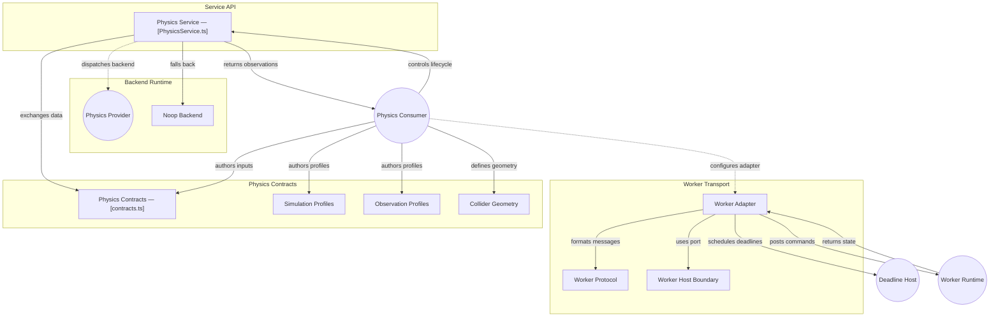

# GitDiagram architecture — @konitif/physics

This architecture view was generated from the public repository by [GitDiagram](https://gitdiagram.com/lemouf/konitif-physics) on 2026-09-20 18:45:09 UTC.

It is a documentation projection of the repository tree, README, and source files sampled by GitDiagram. It does not replace the authored contracts in [catalog.json](catalog.json) and [diagrams.json](diagrams.json), nor does it establish runtime authority.

The Mermaid source keeps GitDiagram's groups, nodes, relationships, and source links. GitDiagram's forced color classes and HTML line breaks are omitted so the diagram remains readable in local previews and dark themes.

- Public repository: [konitif-physics](https://github.com/LeMouf/konitif-physics)
- Interactive diagram: [Open in GitDiagram](https://gitdiagram.com/lemouf/konitif-physics)

## Architecture diagram

## Generated analysis

@konitif/physics is a headless physics lifecycle and contract package. A consumer authors a subject and profiles, configures PhysicsService, selects an injected backend, loads the subject, submits targets or impulses, steps or synchronizes simulation, and reads joint/body observations before disposal. The default Noop backend records targets without simulation. An optional worker adapter transports backend commands and state through an explicit worker boundary; actual physics engines and worker hosts remain external. Sampled source covers orchestration, contracts, fallback behavior, and worker transport, but not concrete engine providers.
